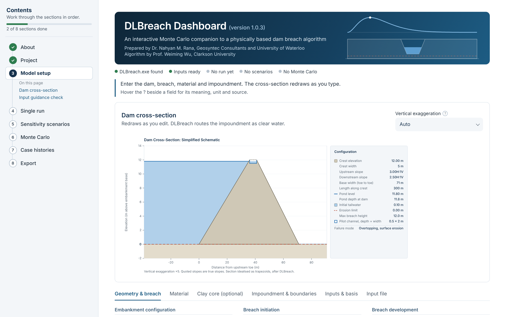
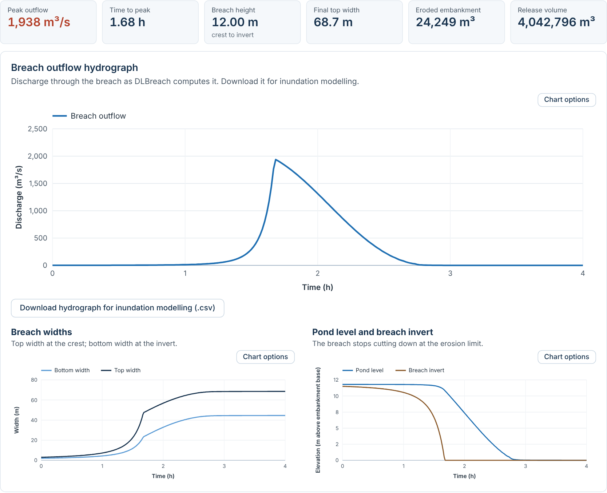
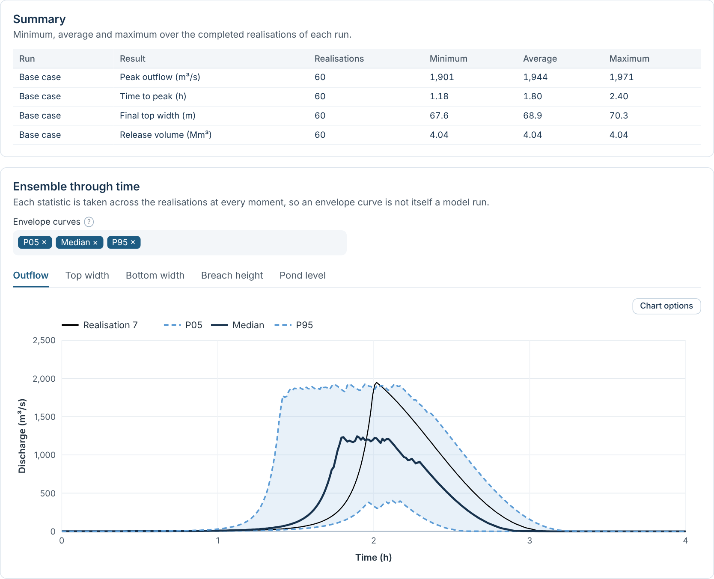
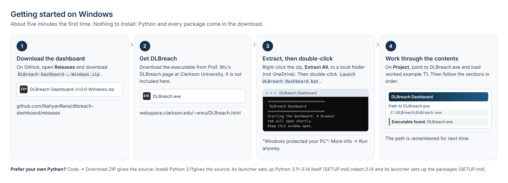

# DLBreach Dashboard

**An interactive Monte Carlo companion to a physically based dam breach algorithm.**

[](https://github.com/NahyanRana/dlbreach-dashboard/actions/workflows/tests.yml)
[](LICENSE)
[](https://doi.org/10.5281/zenodo.23307440)

A Streamlit interface to **DLBreach**, the dam and levee breach model
developed by Prof. Weiming Wu, Clarkson University (Wu 2013, 2016). It
gives DLBreach structured input in practitioner units, a live
cross-section, sensitivity scenarios, Monte Carlo ensembles, comparison
with measured failures, and a report appendix in PDF or Word.

Every simulation is run by the published DLBreach executable. The
dashboard writes the input file, runs the model and presents its output.
It adds no physics to the model.

<!-- Screenshots are mock-ups of the v1.0 layout. -->


> **Scope (v1.0.3).** Water-retaining embankment dams.
> Solid waste dams (tailings, coal ash) are in development and switched off
> in this build; see [TAILINGS_TODO.md](TAILINGS_TODO.md).

---

## Contents

- [What it does](#what-it-does)
- [Foundational methodology](#foundational-methodology)
- [How it runs](#how-it-runs)
- [Obtaining DLBreach](#obtaining-dlbreach)
- [Install and start (Windows)](#install-and-start-windows)
- [Quick start](#quick-start)
- [Limitations](#limitations)
- [Security and privacy](#security-and-privacy)
- [Verification and tests](#verification-and-tests)
- [How to cite](#how-to-cite)
- [Licence and attribution](#licence-and-attribution)
- [Contact](#contact)

## What it does

Eight sections, worked through in order from a contents panel:

| Section | What it gives you |
|---|---|
| **About** | The model, the dashboard, limitations, how to cite. |
| **Project** | DLBreach executable, four worked examples (12 m dam: two overtopping, two piping), open or save a project, load an existing DLBreach input file (every card is kept, including those the dashboard does not edit, and the file is checked to be written back unchanged), site datum, templates for every input file. |
| **Model setup** | Embankment, breach initiation, material, an optional clay core (overtopping submode 3) and impoundment in practitioner units. The cross-section redraws as you type and shows the core and any clay cover. Inputs are checked against the DLBreach technical report, and the *Input file* tab shows exactly what DLBreach will read. |
| **Single run** | Outflow hydrograph, breach widths and levels through time, the breach seen from downstream between its abutments (step through or play; a one-sided breach is drawn against the abutment that does not erode), downloads for inundation modelling. |
| **Sensitivity scenarios** | One column per run, run all, compare outflow, widths, depth and pond level. |
| **Monte Carlo** | Ensembles around any run: summary, P05–P95 envelopes through time for outflow and breach geometry, input-against-result charts, any single realisation to inspect and download. |
| **Case histories** | Your single run, and optionally your scenario runs and Monte Carlo realisations, among measured failures of water-retaining dams (Froehlich 2016a; Xu and Zhang 2009). |
| **Export** | Report appendix in PDF or Word with the sections you choose. |





*The screenshots are illustrative mock-ups of the layout. Their numbers
are not DLBreach results.*

## Foundational methodology

The dashboard implements an established approach rather than a new method:
the probabilistic use of a simplified, physically based breach model, as
described by Palmen and Kent (2024).

**The breach model.** DLBreach (Wu 2013, 2016) simulates embankment
breaching from the hydraulics of the breach flow, sediment transport and
the geotechnical stability of the embankment. It represents the
embankment geometry, material properties and impoundment storage
explicitly, and covers overtopping and piping in homogeneous and
composite embankments. Its short run times make it practical to run many
times.

**The probabilistic framework.** Palmen and Kent (2024) set out a method
for using DLBreach within a Monte Carlo framework:

- define statistical distributions for uncertain inputs, such as material
  properties and geometry;
- sample them to create one DLBreach input file per realisation;
- run each realisation and collate outputs such as peak discharge or
  breach depth;
- check that enough realisations have been run;
- test outputs for correlation with inputs, to identify the parameters
  that most influence the result;
- select representative realisations for further deterministic modelling,
  such as runout;
- check the results for reasonableness against databases of historical
  dam failures.

The method also recommends an initial run with median values, varying
individual parameters to identify the most influential ones. Other breach
models that use a Monte Carlo approach include Embrea, formerly HR Breach
(HR Wallingford 2024), and McBreach (Kleinschmidt 2024).

**What the dashboard adds.** The dashboard provides an interactive
interface to this approach: input in practitioner units with a live
cross-section, sensitivity scenarios, Monte Carlo ensembles run in
parallel, statistics and envelopes through time, comparison with the
case histories of Froehlich (2016a) and Xu and Zhang (2009), and report
export. It adds no physics to DLBreach. Every simulation is run by the
published DLBreach executable.

**References**

- Palmen, L., & Kent, N. (2024). Use of a physically based erosion breach
  model for water and tailings dams within a probabilistic framework.
  *ANCOLD 2024 Conference Proceedings*.
- Wu, W. (2013). Simplified physically based model of earthen embankment
  breaching. *Journal of Hydraulic Engineering*, 139(8), 837–851.
- Wu, W. (2016). *Introduction to DLBreach: A Simplified Physically-Based
  Dam/Levee Breach Model*, version 2016.4. Clarkson University.
- HR Wallingford (2024). *Embrea*. <https://www.dambreach.org/tools/embrea>
- Kleinschmidt (2024). *McBreach*. <https://www.kleinschmidtgroup.com/mcbreach/>

## How it runs

The dashboard runs on your own Windows computer. You download it, double-
click the launcher, and it opens in your web browser as a local page. It
runs DLBreach directly, including Monte Carlo runs in parallel, and your
inputs and results stay on your computer. There is no online version:
a web page cannot start DLBreach on a visitor's computer.

## Obtaining DLBreach

DLBreach is **not** distributed with this dashboard. Download it from
Prof. Wu's page, which also holds the technical report and the input and
output file specifications:

<https://webspace.clarkson.edu/~wwu/DLBreach.html>

## Install and start (Windows)



**Windows download (recommended): nothing to install.**

1. **Download the dashboard.** On the
   [Releases page](https://github.com/NahyanRana/dlbreach-dashboard/releases),
   download `DLBreach-Dashboard-<version>-Windows.zip` from the latest
   release. It holds the dashboard with Python and every package it uses,
   already installed (about 100 MB).
2. **Get DLBreach** from Prof. Wu's page (above).
3. **Extract, then double-click.** Right-click the zip, **Extract All**, to
   a local folder, **not** OneDrive or another synced folder, for example
   `C:\Users\<you>\DLBreach-Dashboard`. Double-click
   **`Launch DLBreach Dashboard.bat`** in it. If Windows shows *Windows
   protected your PC*, click **More info → Run anyway**. Keep the black
   window open while you work.
4. **In the browser tab that opens**, go to **Project**, point to
   `DLBreach.exe` (the path is remembered), and load worked example **T1**.
   Then follow the contents panel from top to bottom.

To update, extract the new release to a new folder. Save your project
first (**Project → Save project**) and open it in the new version.

**From the source, with your own Python.** Install Python 3.13 from
<https://www.python.org/downloads/> (tick **Add python.exe to PATH**;
3.11 to 3.14 work). On GitHub, **Code → Download ZIP**, extract it to a
local folder and double-click `Launch DLBreach Dashboard.bat`: the first
run creates an isolated environment in the folder and installs the
packages (about two minutes); later runs start in seconds.

Detailed instructions, updating from an earlier version, and a table of
the files are in [SETUP.md](SETUP.md).

**macOS and Linux.** The dashboard runs, but DLBreach is a Windows
executable. Create an environment and start it by hand:

```bash
python3 -m venv .venv && source .venv/bin/activate
pip install -r requirements.txt
streamlit run app.py
```

## Quick start

With worked example T1 loaded:

1. **Model setup.** Check the cross-section: a 12 m dam with the pond
   0.3 m above the invert of a 0.5 m pilot channel. The input guidance
   check at the foot of the page compares the inputs with the DLBreach
   technical report.
2. **Single run.** Press **Run DLBreach**. Peak outflow, time to peak,
   breach height and widths appear as tiles, with the hydrograph and the
   breach seen from downstream below. **Download hydrograph** gives a CSV
   for inundation modelling.
3. **Sensitivity scenarios.** Keep the default three runs varying D50,
   enter a D50 for each run, press **Run all**.
4. **Monte Carlo.** Keep the defaults (D50 and Manning's n, 100
   realisations around the base case) and press **Run Monte Carlo**. Review the envelopes and pick any realisation to
   play.
5. **Case histories**, then **Export** a PDF or Word appendix.

Hover the **?** beside any field for its meaning, unit and source. Every
chart has a **Chart options** button for axis limits, log scales, and line
colour and style.

## Limitations

- **Developed for water-retaining dams.** DLBreach was developed and tested
  against laboratory experiments and historical failures of
  water-retaining embankments and levees (Wu 2016). It was not developed or
  validated for tailings or coal combustion residual (solid waste) dams.
- **Clear water only.** DLBreach routes the impoundment as clear water;
  stored solids are not eroded or carried by the model.
- **Simplified breach geometry.** The breach is a trapezoid, and results
  depend strongly on uncertain inputs such as grain size, erosion limit and
  Manning's n. Sensitivity and Monte Carlo analysis are recommended.
- **Results need an engineer.** Dam breach results must be interpreted by a
  qualified engineer or geoscientist familiar with the structure and the
  governing regulatory framework. See the disclaimer on the About page.

## Security and privacy

- **Local version.** Runs entirely on your computer. The dashboard serves
  only `localhost` (not your network), sends no usage statistics, and
  uploads nothing. Inputs are autosaved to a file in the dashboard folder.
- **No hosted service.** Nothing is run on a server, so one user's data
  can never reach another's.
- **DLBreach** is obtained from Prof. Wu and run on your own computer.
- Do not post confidential project data in issues.

## Verification and tests

The dashboard was verified against a project benchmark: loading the
original DLBreach input and running it reproduces the original DLBreach
results exactly. The benchmark is project data; it and its regression
checks are kept out of this repository.

| Test | What it checks |
|---|---|
| `test_core.py` | Input cards, output parsing, sampling and statistics, units and porosity, the Fontaine and Martin (2015) worked example, case-history counts against Froehlich (2016a) and Xu and Zhang (2009), the Wu (2016) Eq. 3.5 flow-depth rule. |
| `test_app_headless.py` | Every page, scenario and Monte Carlo results, PDF and Word export, without a browser. |
| `dev/apptest_smoke.py` | Every page in real Streamlit, failing on any error shown on screen. |
| `dev/qa_features.py` | 121 feature checks: every page's actions for all four worked examples, including run packages (download inputs, run, upload outputs), project and template files, uploads, autosave, loading input files card for card (with Prof. Wu's validation inputs), the clay core tab and the drawings, scenario and Monte Carlo runs on the case-history charts, and the security settings. |
| `dev/qa_walkthrough.py` | A first-time user's path through all eight sections, pressing the real buttons, against a stand-in executable. |

Prof. Wu's own validation cases can be loaded and checked against his
report: see [docs/WU_VALIDATION.md](docs/WU_VALIDATION.md). For the Teton and
Banqiao cases, runs through the dashboard matched direct DLBreach runs
(owner's check, October 2026).

**How it was built.** The dashboard was developed with an AI coding
assistant, under the author's direction and engineering review. Every
release is checked by the automated tests above, independent code
review, the project benchmark and Prof. Wu's validation cases, and the
results remain DLBreach's: the dashboard adds no physics of its own.

The QA record, including an independent review, is in
[docs/QA_REPORT.md](docs/QA_REPORT.md). GitHub Actions runs the tests on every push, Python 3.11 to 3.14: the first
three on Windows and Linux, and the two that use the stand-in on Linux
(it cannot run on Windows). The stand-in in `dev/` imitates DLBreach's file interface
for testing only; it is **not** DLBreach and its numbers mean nothing. See
[dev/README.md](dev/README.md).

## How to cite

Please cite the model, the method it implements (Palmen and Kent 2024;
see [Foundational methodology](#foundational-methodology)), and the
dashboard where it was used:

- Wu, W. (2013). Simplified physically based model of earthen embankment
  breaching. *Journal of Hydraulic Engineering*, 139(8), 837–851.
  <https://doi.org/10.1061/(ASCE)HY.1943-7900.0000741>
- Wu, W. (2016). *Introduction to DLBreach: A Simplified Physically-Based
  Dam/Levee Breach Model*, version 2016.4. Technical report, Clarkson
  University.
- Palmen, L., & Kent, N. (2024). Use of a physically based erosion breach
  model for water and tailings dams within a probabilistic framework.
  *ANCOLD 2024 Conference Proceedings*.
- Rana, N.M. (2026). *DLBreach Dashboard* (version 1.0.3) [software].
  Zenodo. <https://doi.org/10.5281/zenodo.23307440>

GitHub's **Cite this repository** button (from [CITATION.cff](CITATION.cff))
gives the dashboard reference in APA and BibTeX. The DOI above always
resolves to the latest version. Each release also has its own DOI, shown
on its Zenodo record; version 1.0.0 is
[10.5281/zenodo.23307441](https://doi.org/10.5281/zenodo.23307441).

Related talk: Rana, N.M. (2027). *DLBreach Dashboard: An Open-Source, Interactive, Monte Carlo Interface to a Physical-Based Dam Breach Algorithm*. Lightning talk, International
Commission on Large Dams (ICOLD) Conference, Daejeon, South Korea,
21–27 May 2027 (abstract submitted).

## Licence and attribution

The dashboard is released under the [MIT licence](LICENSE).

DLBreach is the work of Prof. Weiming Wu, Clarkson University. It is not
distributed with this software and is not covered by this licence. Prof.
Wu was consulted during development; the dashboard is independent of, and
not endorsed by, him or Clarkson University. The embedded case-history
data (Froehlich 2016a; Xu and Zhang 2009; and, for the solid waste pages
switched off in this build, Rana et al. 2021 and Adria et al. 2023 and
2024) remain subject to the terms of their original publications, which
are cited on the pages where they are used.

## Contact

Questions, feedback and bug reports: open an
[issue](https://github.com/NahyanRana/dlbreach-dashboard/issues) or write
to **nahyan.rana@geosyntec.com**.

Prepared by Dr. Nahyan M. Rana, Geosyntec Consultants and University of
Waterloo.
